# Лог работы с ИИ (DeepSeek)

**Проект:** Лендинг обжарки кофе «Кварта»  
**Инструмент:** DeepSeek (через веб-интерфейс)  
**Сайт:** https://kvarta-brife.vercel.app *(замени на свой реальный URL)*  
**Репозиторий:** https://github.com/svirilinmax/kvarta-brife

В этом логе описан реальный процесс разработки: от генерации boilerplate до деплоя. Я не просто копировал ответы ИИ, а проверял их, находил ошибки (особенно в специфике Supabase/Vercel) и исправлял.

---

## Шаг 1: Инициализация проекта

**Промпт:** «Ты — опытный Python-разработчик. Помоги настроить структуру проекта для лендинга... Стек: FastAPI + Supabase + Vercel».

**Результат ИИ:** Структура папок, конфиги, `requirements.txt`, `vercel.json`.

**Что исправил:**
* В `requirements.txt` ИИ указал неверную версию `ruff`. Зафиксировал рабочую версию.
* В `vercel.json` изначально был указан `runtime: "python3.12.7"`. Vercel принимает только мажор.минор (`python3.12`). Исправил.
* ИИ предложил добавить `.env` в `.gitignore` — проверил, всё ок.

**Скриншоты:**

---

## Шаг 2: Подключение Supabase и Alembic

**Промпт:** «Настрой подключение к Supabase и первую миграцию Alembic».

**Результат ИИ:** Код для `settings.py`, `models.py`, `env.py` для Alembic. ИИ предложил использовать `asyncio.run` для миграций.

**Что сделал сам:**
* Понял, что для Supabase нужны два URL: `DATABASE_URL` (Transaction pooler, порт 6543 — для приложения) и `DIRECT_URL` (прямой, порт 5432 — для Alembic).
* Через панель Supabase скопировал реальные строки подключения.

**Ошибки ИИ:**
1. **Хардкод URL в `env.py`:** ИИ сгенерировал код с захардкоженным битым URL. Заменил на чтение из `settings.direct_url`.
2. **Alembic и pooler:** Изначально Alembic брал `database_url` (порт 6543), что неоптимально для DDL. Исправил `env.py` на использование `direct_url`.
3. **Дубли индексов:** В моделях был `index=True`, и в `__table_args__` был `Index(...)`. Alembic создал дубли. Убрал `index=True`.

**Скриншоты:**

---

## Шаг 3: API-эндпоинт и бизнес-логика

**Промпт:** «Реализуй API-эндпоинты с валидацией, дедупликацией, rate limit и honeypot».

**Результат ИИ:** 5 файлов (`validators.py`, `schemas.py`, `services/`, `index.py`).

**Ошибки ИИ и итерации:**
1. **Prepared statements в asyncpg:** ИИ сказал добавить `?prepared_statement_cache_size=0` в URL. SQLAlchemy 2.0 не пробрасывает этот параметр в asyncpg. Пришлось вынести в `connect_args={"statement_cache_size": 0}` в `create_async_engine`. Без этого Supabase Transaction Pooler выдавал ошибку `DuplicatePreparedStatementError`.
2. **UUID без server_default:** ИИ сгенерировал модель с `default=uuid4`, но Alembic autogenerate не подхватывает Python-side defaults. В итоге колонка `id` в БД была `NOT NULL` без дефолта, и `INSERT` падал. Исправил через новую миграцию `ALTER TABLE leads ALTER COLUMN id SET DEFAULT gen_random_uuid()`.

**Что протестировал:** health, успешная заявка, дубль, невалидный телефон, honeypot, rate limit.

**Скриншоты:**

---

## Шаг 4: Тесты (pytest)

**Промпт:** «Напиши тесты на pytest (SQLite in-memory, без реального Supabase)».

**Результат:** 38 passing, coverage 90%.

**Ошибки ИИ (выявлены при запуске тестов):**
1. `PGUUID` — Postgres-only, ломает SQLite-тесты. Заменил на `Uuid(as_uuid=True)`.
2. `BigInteger + autoincrement` — не работает на SQLite (не rowid-alias). Использовал `BigInteger().with_variant(Integer, "sqlite")`.
3. `@lru_cache` на `get_settings()` требует `cache_clear()` в тестах, иначе `monkeypatch.setenv` не работает. Добавил autouse-фикстуру.
4. ИИ не упомянул `aiosqlite` и `python-multipart` — добавил в `requirements.txt`.
5. `ruff` ругался на несуществующее правило `B0008`. Заменил на `B008` (FastAPI `Depends`).

**Главный вывод:** Тесты на SQLite — это лакмус на диалект-зависимость моделей. Код, который «работает на Postgres», может быть не переносимым.

**Скриншоты:**

---

## Шаг 5: Фронтенд (HTML/CSS/JS)

**Промпт:** «Сделай лендинг, тёплый, простой, без пафоса».

**Результат ИИ:** Каркас HTML/CSS/JS. Но ИИ сгенерировал «премиальный» дизайн (градиенты, тени, скругления).

**Что исправил:**
* Переписал CSS-переменные под палитру «тёплый минимализм» (`--ink`, `--paper`, `--accent`).
* Убрал градиенты и тяжёлые тени.
* Добавил JS-маску телефона с фиксированным префиксом `🇧🇾 +375`.
* Добавил передачу продукта в комментарий (кнопка «Заказать» → пишет «Эфиопия Иргачеффе» в комментарий).
* Сделал fallback без JS (скрытое поле `phone_prefix`, склейка на бэкенде).
* Добавил кнопки «Наверх» и «Очистить».

**Скриншоты:**
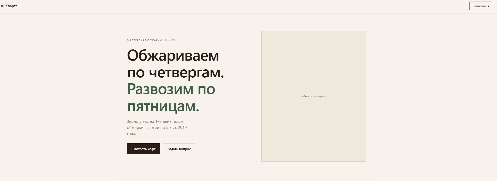
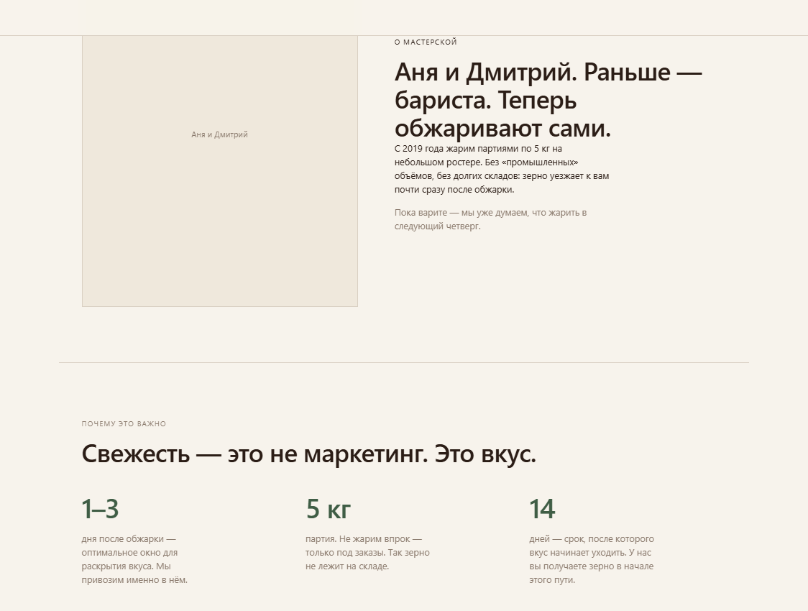
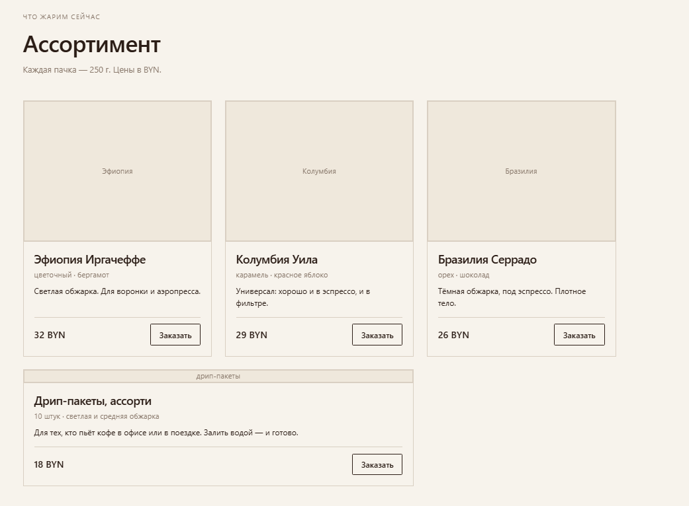
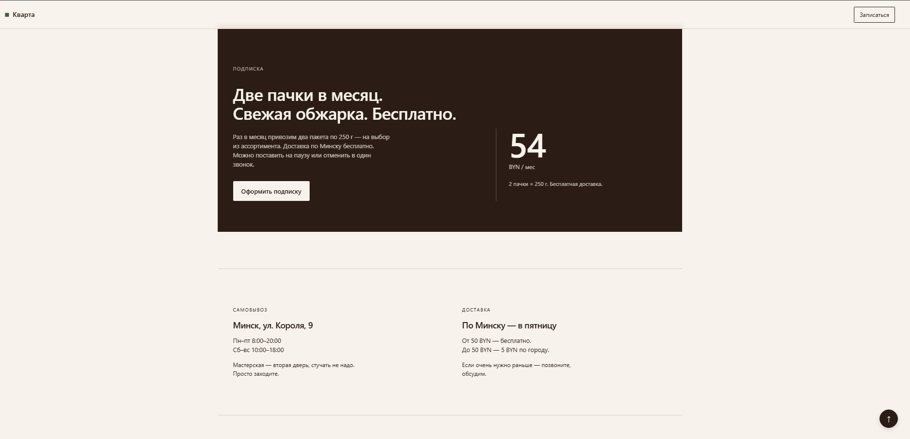
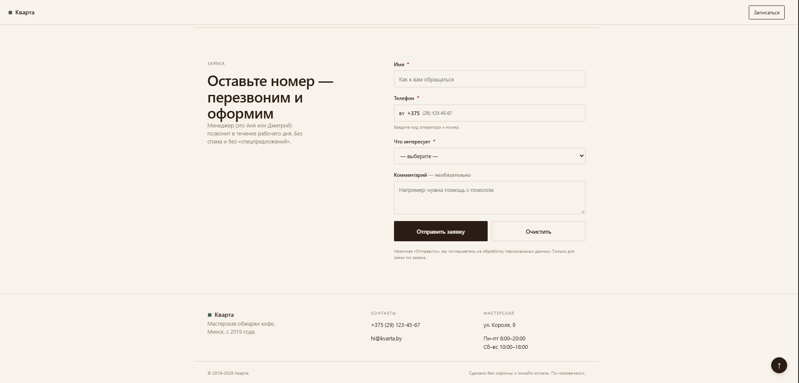
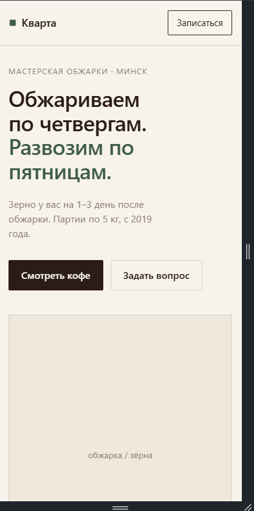
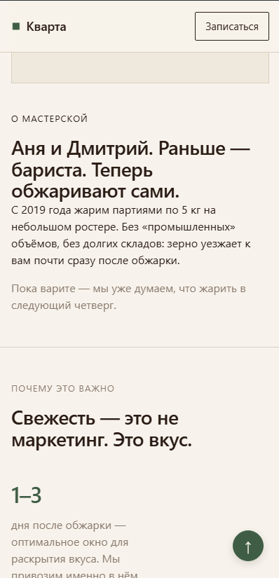
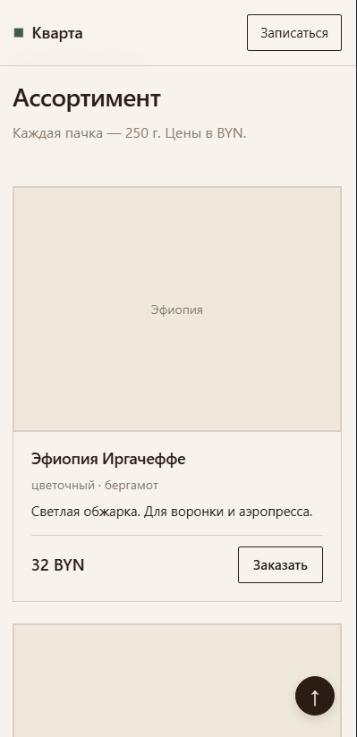
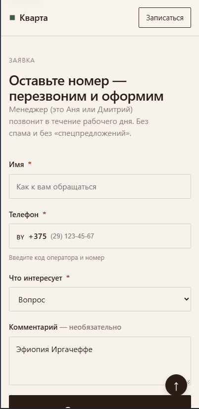

---

## Шаг 6: Картинки и финальный дизайн

**Промпт:** «Как подобрать фото? Опиши размеры. Сделай так, чтобы отображалось».

**Результат:**
* Подобрал 7 фото на Unsplash (обжарка, зёрна, руки — без стоковых улыбок).
* Сжал через Squoosh в WebP (качество 75–80), подогнал размеры под контейнеры (600×800 для hero/founders, 500×375 для карточек).
* Добавил `loading="lazy"`, `width`, `height`, `fetchpriority="high"` для LCP-элемента.
* Сделал отдельную OG-картинку 1200×630.

**Проблемы:** ИИ дал ссылки на Unsplash, но они могут меняться. Пришлось подбирать вручную, чтобы найти идеальные кадры. ИИ также подсказал, что для Hero нужен вертикальный кадр, а для OG — горизонтальный.

**Скриншоты:**
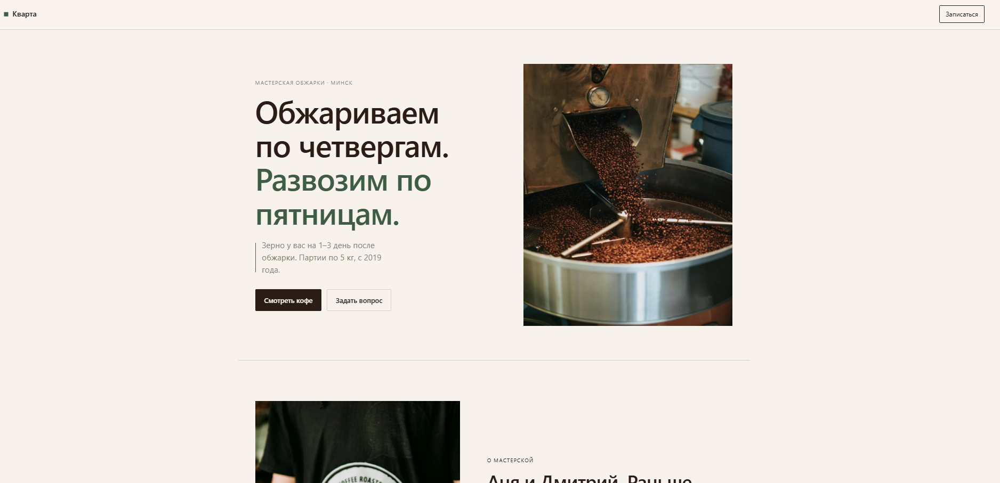
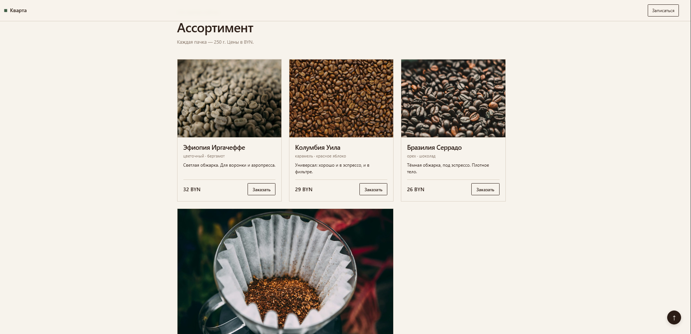
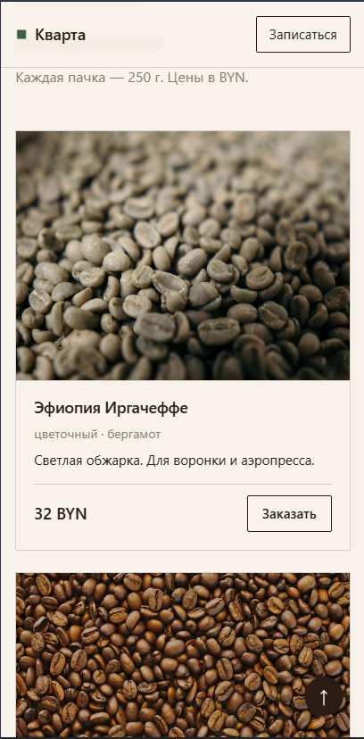
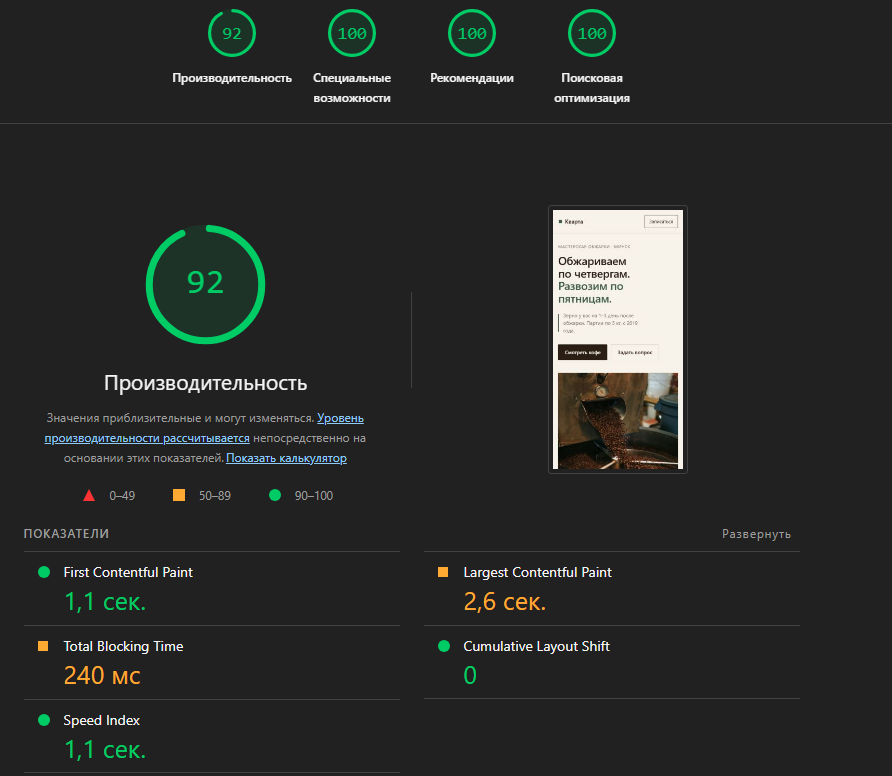
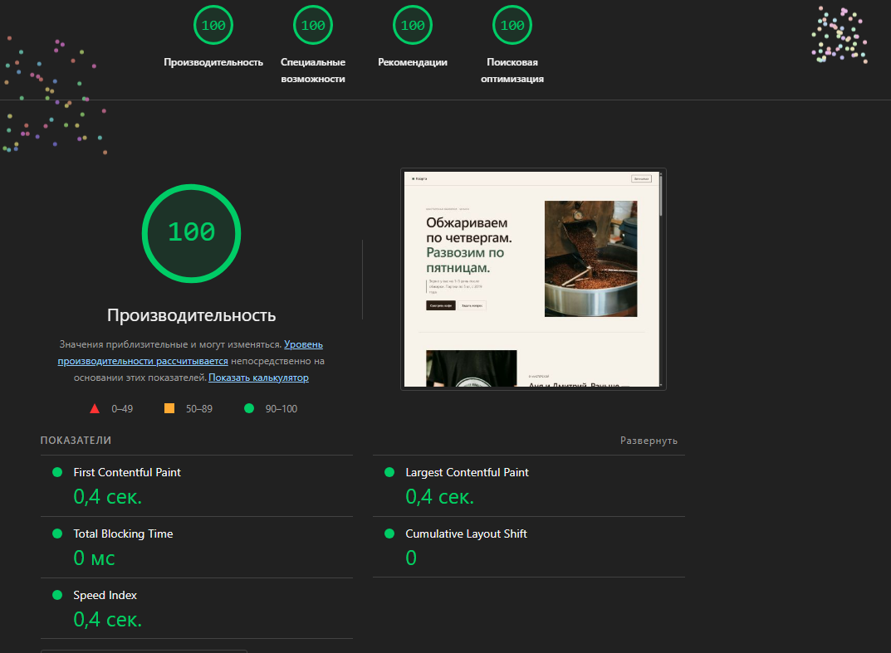

---

## Шаг 7: Деплой на Vercel (итерации)

При переносе на Vercel возникло несколько инфраструктурных проблем. Вот как я их решал:

**Проблема 1: `database_url Field required` (500)**
* **Симптом:** Приложение падало на импорте `settings.py`. Vercel не видел `DATABASE_URL`.
* **Причина:** Переменная была добавлена только в окружение Production, а тестирование шло на Preview. Плюс `pydantic-settings` не читает локальный `.env` на сервере.
* **Решение:** В Vercel (Settings → Environment Variables) добавил `DATABASE_URL` и выбрал опцию **All Environments**.

**Проблема 2: Ошибка кэша подготовленных запросов**
* **Симптом:** Ошибки подключения к БД.
* **Причина:** Supabase Transaction pooler (PgBouncer, порт 6543) не поддерживает кэширование prepared statements в asyncpg.
* **Решение:** Добавил `?prepared_statement_cache_size=0` в `DATABASE_URL` и `statement_cache_size=0` в `connect_args`.

**Проблема 3: 404 на `POST /api/lead`**
* **Симптом:** Запросы уходили, Vercel возвращал 404.
* **Причина:** Правило `rewrites` в `vercel.json` переписывало `/api/lead` на `/api/index.py`. FastAPI внутри функции ожидал `/api/lead`, но получал `/api/index.py`.
* **Решение:** Удалил блок `"rewrites"` из `vercel.json`. Vercel для Python-функций сам маршрутизирует запросы к файлам из `api/`.

**Проблема 4: 404 после исправления маршрутизации**
* **Симптом:** Запросы доходили до функции, но FastAPI отдавал 404.
* **Причина:** Попытка использовать `root_path="/api"` в `FastAPI()` сбила маршрутизацию.
* **Решение:** Убрал `root_path`. Оставил чистый `@app.post("/api/lead")`. Форма заработала.

**Git-история:** Так как фиксы деплоя заняли несколько итераций, я объединил два последних коммита в один чистый `fix: correct vercel routing for api` через `git rebase -i` и `git push --force`, чтобы сохранить историю линейной.

**Скриншоты:**
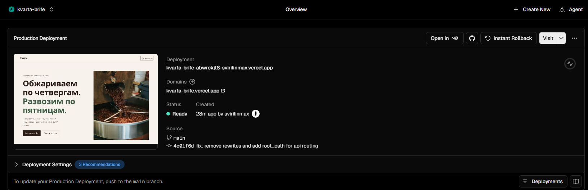
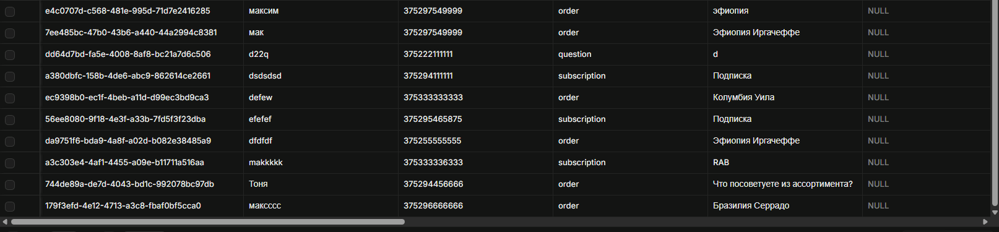
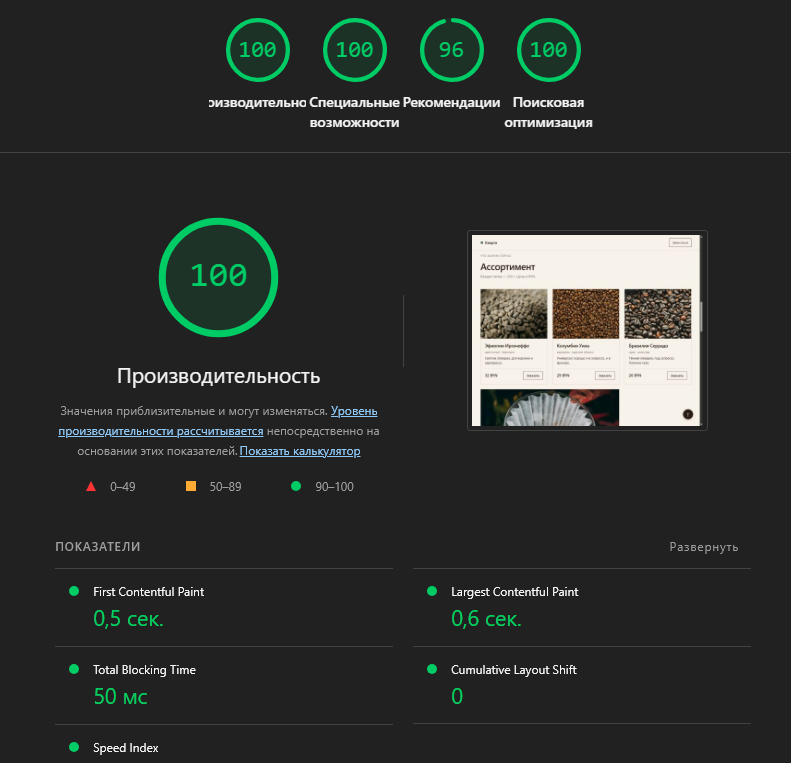

---

## Итоги и выводы

**Что получилось:**
Лендинг с работающей формой, дедупликацией, rate limit, honeypot и UTM-метками. Все критерии приёмки выполнены.

**Главные уроки:**
1. **ИИ не знает контекста.** DeepSeek генерирует «средний» код. Serverless-специфика (Supabase pooler, Vercel rewrites) — это то, что нужно проверять руками.
2. **Тесты на SQLite выявляют диалект-зависимость.** Код, который «работает на Postgres», может упасть на SQLite.
3. **Дизайн ≠ «сделай красиво».** Тёплый минимализм требует явных инструкций, иначе ИИ выдаёт «премиальный глянец».
4. **Деплой — это итерации.** Проблемы с `DATABASE_URL`, `rewrites` и `root_path` — типовые для Vercel + FastAPI. Решаются чтением логов Functions.

**Что не успел:**
* Telegram-бот для дублирования заявок.
* Sentry для сбора ошибок в проде.
* E2E-тесты (Playwright).